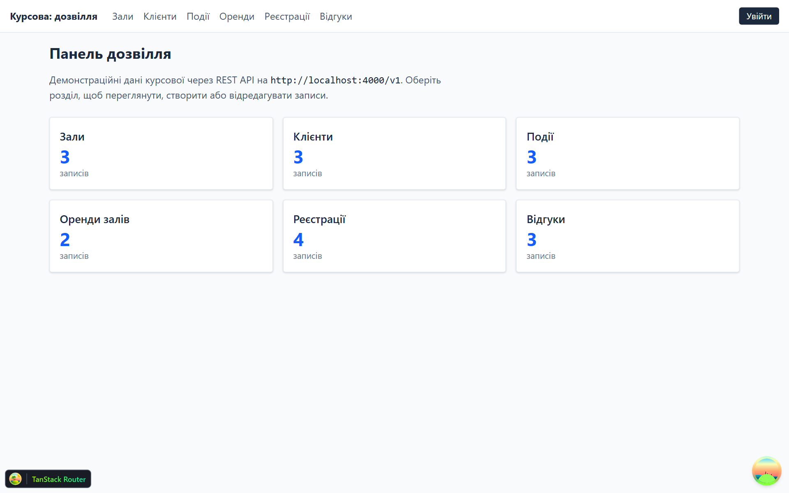
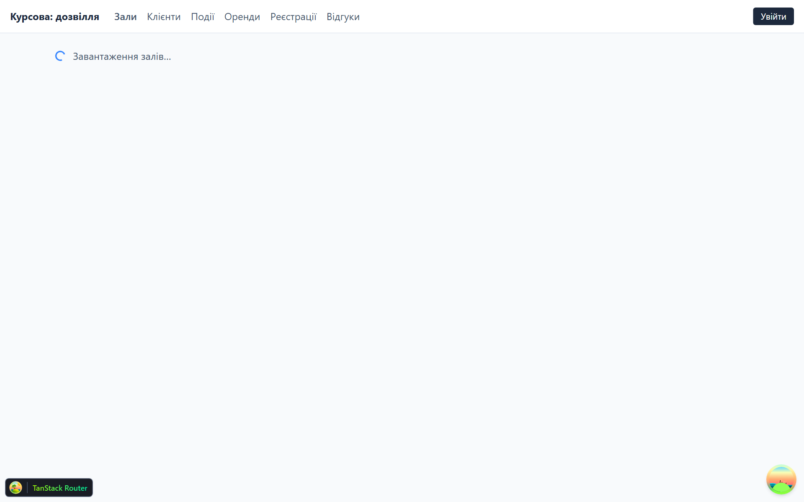
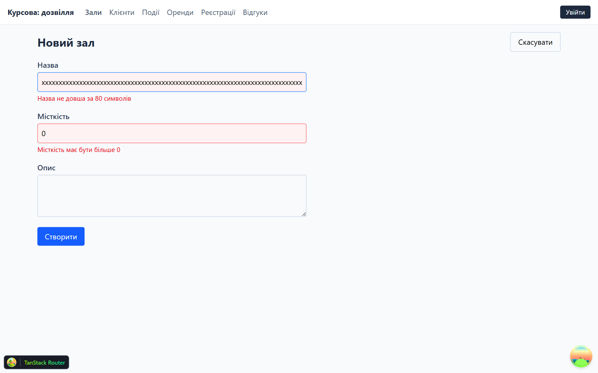
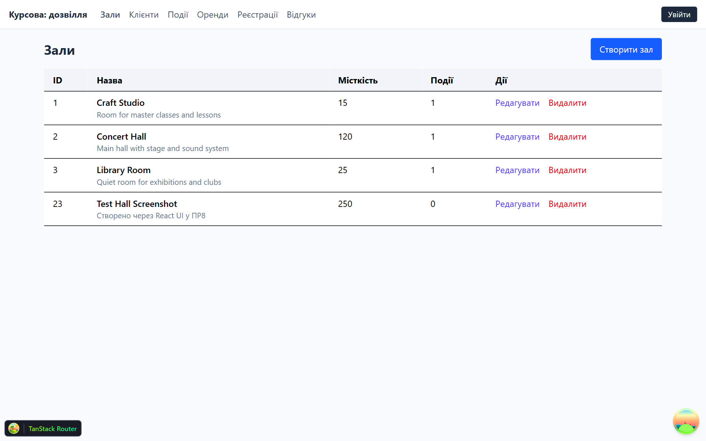
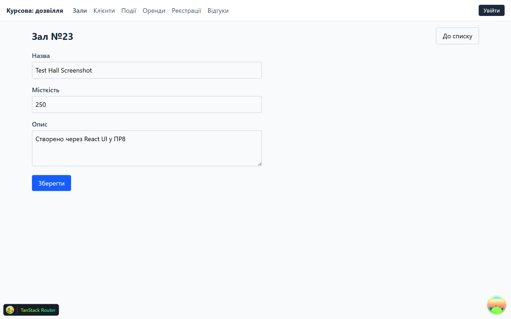
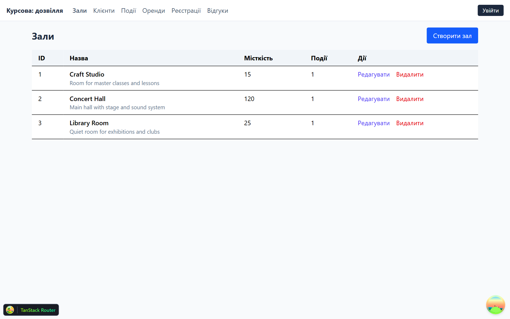
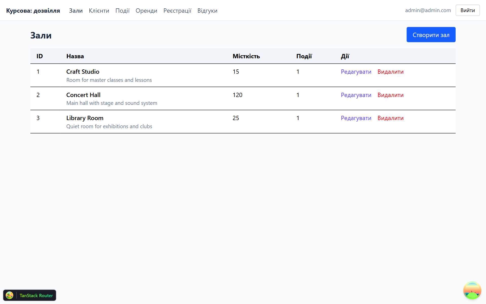
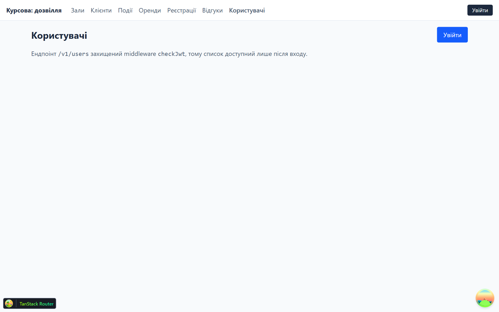
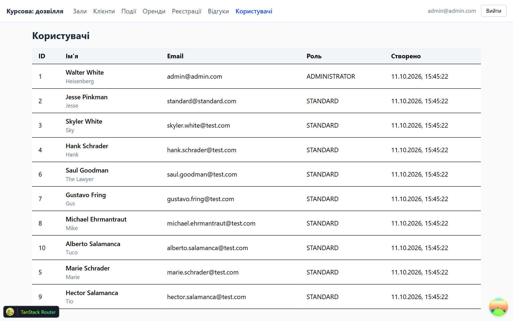
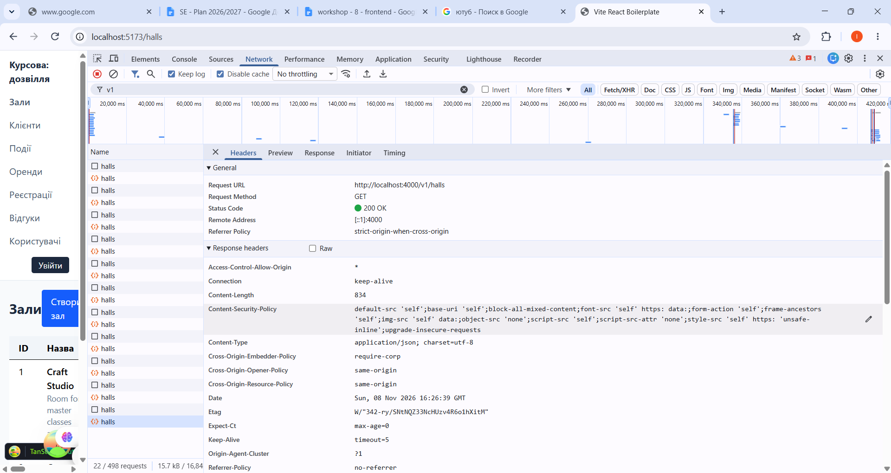

# Курсова робота. Практична робота №8-9: Full-stack інтеграція — UI на базі професійного бойлерплейту

У цьому репозиторії лежать обидві половини застосунку:

- `server/` — REST API (Express + TypeScript + TypeORM + PostgreSQL), портовий варіант курсової з ПР4-ПР6;
- `client/` — React-клієнт на базі [`vite-react-boilerplate`](https://github.com/RicardoValdovinos/vite-react-boilerplate), який споживає це API;
- `docs/screenshots/` — скріншоти до звіту;
- `package.json` у корені — єдині точки входу `npm run db:up`, `npm run dev`, `npm run lint`, `npm run build` для обох половинок.

## Зміст

- [Функціонал](#функціонал)
- [Стек клієнта](#стек-клієнта)
- [Як запустити (Windows)](#як-запустити-windows)
- [Ключовий код](#ключовий-код)
  - [Конфігурація Axios](#конфігурація-axios)
  - [Хуки TanStack Query](#хуки-tanstack-query)
  - [Zod-схеми та форми](#zod-схеми-та-форми)
  - [Обробка помилок бекенду](#обробка-помилок-бекенду)
  - [Логін, Zustand і динамічний токен](#логін-zustand-і-динамічний-токен)
  - [Маршрутизація](#маршрутизація)
- [Скріншоти](#скріншоти)
- [Перевірки якості](#перевірки-якості)
- [Специфіка реалізації та проблеми](#специфіка-реалізації-та-проблеми)
- [Висновки](#висновки)

## Функціонал

Клієнт показує довідник закладу дозвілля через шість розділів CRUD:

| Розділ | Маршрути | Операції |
| --- | --- | --- |
| Зали | `/halls`, `/halls/new`, `/halls/$hallId` | список, створення, редагування, видалення |
| Клієнти | `/clients`, `/clients/new`, `/clients/$clientId` | те саме |
| Події | `/events`, `/events/new`, `/events/$eventId` | те саме (з вибором зали) |
| Оренди залів | `/hall-rentals`, `/hall-rentals/new`, `/hall-rentals/$rentalId` | те саме (подія + зал, дати) |
| Реєстрації на події | `/event-registrations`, `.../new`, `.../$registrationId` | те саме (подія + клієнт + місця) |
| Відгуки | `/feedbacks`, `/feedbacks/new`, `/feedbacks/$feedbackId` | те саме (оцінка 1-5, коментар) |
| Користувачі | `/users` | список захищеним ендпоінтом `GET /v1/users` (потрібен JWT ролі ADMINISTRATOR) |
| Логін | `/login` | `POST /v1/auth/login`, токен у Zustand |
| Дашборд | `/` | лічильники записів по шести розділах |

Списки показують пов'язані сутності (події зали, кількість подій у оренди), форми валідуються Zod-схемами, побудованими за тими самими правилами, що й DTO на бекенді; помилки валідації з API підставляються у відповідні поля форми.

## Стек клієнта

Vite 8.0.16 (rolldown) + React 19.2 + TypeScript 6.0.3 (strict), TanStack Router 1.170 (file-based), TanStack Query 5.101, React Hook Form 7.80 + `@hookform/resolvers` 5.4 + Zod 4.4, Zustand 5.0 (persist), Axios 1.21, Tailwind CSS 4.3, ESLint 9.39 + Prettier, Vitest 4.1 + Playwright 1.61.

## Як запустити (Windows)

Передумови: Node.js 20+, pnpm 10+, npm, Git Bash, Docker Desktop (запустити `Docker Desktop.exe`, інакше `docker ps` падає на `npipe`), порт `8432` вільний.

```powershell
# 1. Бекенд
cd server
npm install
copy .env.example .env       # у .env лишаємо PG_HOST=localhost, PG_PORT=8432
npm run db:up                # піднімає контейнер db_postgres
npm run migration:run:dev
npm run seed:run:dev
npm run dev                  # http://localhost:4000/v1

# 2. Клієнт (окремий термінал)
cd ../client
pnpm install
copy .env.example .env       # VITE_API_BASE_URL="http://localhost:4000/v1"
pnpm dev                     # http://localhost:5173
```

Або з кореня репозиторію: `npm install && npm run dev` запускає обидва процеси через `concurrently`.

Демо-акаунт для входу: `admin@admin.com` / `pass1` (роль `ADMINISTRATOR`).

## Ключовий код

### Конфігурація Axios

`client/src/lib/axios.ts` — єдиний HTTP-клієнт застосунку. Базову адресу дає `.env`, а заголовок `Authorization` інтерцептор читає зі сховища під час кожного запиту, тому щойно отриманий токен стає активним без перезавантаження сторінки.

```ts
export const apiClient = axios.create({
	baseURL: import.meta.env.VITE_API_BASE_URL,
	headers: { "Content-Type": "application/json" },
});

apiClient.interceptors.request.use((config) => {
	const token = readStoredToken() ?? envToken;
	if (token) {
		config.headers.Authorization = `Bearer ${token}`;
	}
	return config;
});

apiClient.interceptors.response.use(
	(response) => response,
	(error: AxiosError) => {
		const normalized = toApiRequestError(error);
		console.error("API Error:", normalized.message);
		return Promise.reject(normalized);
	}
);
```

Якщо у `.env` задано `VITE_API_AUTH_TOKEN` (базове завдання п.1), він працює як fallback: до входу кожен запит іде з цим заголовком, після входу — з JWT із сховища, бо `readStoredToken()` має пріоритет над конвертом.

### Хуки TanStack Query

Кожен розділ має папку `src/features/<entity>/` з `types.ts` (модель + Zod-схема), `api.ts` (запити + хуки) і `pages/` (UI). Жоден компонент не використовує `useState` + `useEffect` для даних.

```ts
const getHalls = async (): Promise<Array<Hall>> =>
	unwrap(await apiClient.get<ApiSuccessBody<Array<Hall>>>("/halls"));

const deleteHall = async (id: number): Promise<void> => {
	await apiClient.delete<ApiSuccessBody<Hall>>(`/halls/${id}`);
};

export const useHalls = (): UseQueryResult<Array<Hall>> =>
	useQuery<Array<Hall>>({ queryKey: ["halls"], queryFn: getHalls });

export const useCreateHall = (): UseMutationResult<Hall, Error, HallFormValues> => {
	const queryClient = useQueryClient();
	const navigate = useNavigate();

	return useMutation({
		mutationFn: createHall,
		onSuccess: () => {
			void queryClient.invalidateQueries({ queryKey: ["halls"] });
			void navigate({ to: "/halls" });
		},
	});
};
```

Мутація оновлення, крім інвалідації списку, ще й оновлює кеш деталі через `setQueryData`, щоб сторінка редагування не показувала застарілі значення:

```ts
onSuccess: (hall) => {
	void queryClient.invalidateQueries({ queryKey: ["halls"] });
	queryClient.setQueryData(["halls", hall.id], hall);
	void navigate({ to: "/halls" });
}
```

Оренди, реєстрації та відгуки інвалідують додатково `["events"]` і `["clients"]`, бо ці списки відображають вкладені колекції.

### Zod-схеми та форми

Схема — джерело і типу значень форми, і повідомлень. Оскільки бекенд приймає числа в JSON, а `<input type="number">` дає рядок, застосовано `z.coerce.number()`, і тоді тип вхідних даних форми відрізняється від типу після валідації:

```ts
export const hallSchema = z.object({
	name: z.string().trim().min(1, "Назва зали обов'язкова").max(80, "Назва не довша за 80 символів"),
	capacity: z.coerce.number().int("Місткість має бути цілим числом").positive("Місткість має бути більше 0"),
	description: z.string().trim().max(500, "Опис не довший за 500 символів").optional(),
});

export type HallFormValues = z.infer<typeof hallSchema>;
export type HallFormInput = z.input<typeof hallSchema>;
```

```tsx
const { register, handleSubmit, reset, setError, formState: { errors } } =
	useForm<HallFormInput, unknown, HallFormValues>({
		resolver: zodResolver(hallSchema),
		defaultValues: { name: "", description: "" },
	});
```

Сторінка редагування дістає `id` з параметра маршруту (`useParams({ from: "/halls/$hallId" })`) і заповнює форму `reset()` у `useEffect`, коли дані з API нарешті приходять.

### Обробка помилок бекенду

Бекенд відповідає конвертом `{ message, data }`, а помилку — тілом `{ errorType, errorMessage, errorsValidation }`. `client/src/lib/api.ts` перетворює `AxiosError` на `ApiRequestError` із полями-помилками, а `applyServerFieldErrors` розкладає `errorsValidation` по полях React Hook Form:

```ts
export const applyServerFieldErrors = <T extends Record<string, unknown>>(
	setError: UseFormSetError<T>,
	error: unknown,
): boolean => {
	if (!(error instanceof ApiRequestError) || error.fieldErrors.length === 0) {
		return false;
	}

	for (const entry of error.fieldErrors) {
		const [field, message] = Object.entries(entry)[0] ?? [];
		if (field && message) {
			setError(field as Path<T>, { type: "server", message });
		}
	}

	return true;
};
```

### Логін, Zustand і динамічний токен

```ts
export const useAuthStore = create<AuthState>()(
	persist(
		(set) => ({
			token: null,
			signIn: (token: string): void => {
				set({ token });
			},
			signOut: (): void => {
				set({ token: null });
			},
		}),
		{ name: "kpz8-auth" }
	)
);
```

`useLogin` — це `useMutation` на `POST /v1/auth/login`; бекенд повертає `data` у форматі `"Bearer <jwt>"`, тому токен очищується від префікса перед збереженням, щоб інтерцептор не подвоїв `Bearer`. Після успіху `signIn(token)` + `navigate({ to: "/halls" })`.

Компонент навігації читає з токена JWT-кліми (`readJwtClaims`) без зайвих запитів, тому в шапці видно email і кнопку «Вийти».

### Маршрутизація

Файлова маршрутизація TanStack Router: кожен файл у `src/routes/` експортує `Route = createFileRoute(...)`, а `routeTree.gen.ts` генерує плагін `vite-plugin-tsrouter` під час `pnpm dev`. Сторінки списку лежать у директорних маршрутах:

```
src/routes/halls/index.tsx        -> createFileRoute("/halls/")     -> HallsListPage
src/routes/halls/new.tsx          -> createFileRoute("/halls/new")  -> HallCreatePage
src/routes/halls/$hallId.tsx      -> createFileRoute("/halls/$hallId")
```

## Скріншоти

| Файл | Що показано |
| --- | --- |
| `8-01-dashboard.png` | Дашборд з лічильниками по шести розділах |
| `8-02-loading-halls.png` | Список залів у стані `isLoading` (індикатор завантаження) |
| `8-03-zod-validation-errors.png` | Помилки валідації Zod на формі створення зали |
| `8-04-hall-created.png` | Список після створення нового запису |
| `8-05-hall-edit-prefilled.png` | Сторінка редагування, значення підтягнуті з API |
| `8-06-hall-updated.png` | Список після `PATCH` (місткість змінена на 310) |
| `8-07-hall-deleted.png` | Список після видалення через `window.confirm` |
| `8-08-login-page.png` | Форма входу |
| `8-09-logged-in-nav.png` | Навігація після входу: email + «Вийти» |
| `8-10-users-anonymous.png` | `/users` без токена: запит не надсилається |
| `8-11-users-list.png` | `/users` після входу — захищений ендпоінт відповів 200 |
| `8-12-network-devtools.png` | Вкладка Network: реальний `GET http://localhost:4000/v1/halls` → 200 |














## Перевірки якості

| Перевірка | Команда | Результат |
| --- | --- | --- |
| Типи клієнта | `pnpm exec tsc --noEmit` | 0 помилок |
| ESLint клієнта | `pnpm lint` (`--max-warnings 0`) | 0 помилок, 0 попереджень |
| Збірка клієнта | `pnpm build` | успішно, основний чанк 577 kB |
| Юніт-тести | `pnpm exec vitest run src/` | 5 тестів (`src/lib/datetime.test.ts`) |
| E2E | `pnpm exec playwright test e2e/halls.spec.ts` | 3 тести пройшли (список, валідація, захищений ендпоінт) |
| Типи + ESLint бекенду | `npm run lint` у `server/` | 0 помилок |

CRUD-сценарій (створення → редагування → видалення) перевірено в браузері проти реального API; тестовий запис «Test Hall Screenshot» після перевірки видалено, у базі лишились три сид-зали.

Щоб побачити індикатор завантаження на `8-02`, відповідь API навмисно затримували на 2 с локальним перехопленням запиту в Playwright — сам застосунок при цьому не змінювався.

## Специфіка реалізації та проблеми

- **Вкладені маршрути з'їдали сторінку списку.** Поки файли лежали як `routes/halls.tsx`, `routes/halls.new.tsx`, `routes/halls/$hallId.tsx`, генерований `routeTree` робив останні двоє дітьми маршруту `/halls`, а батьківський компонент не мав `<Outlet/>` — тому `/halls/2` показував список. Вирішено перебудовою на директорні маршрути (`halls/index.tsx` + сусідні `new.tsx` і `$hallId.tsx`, батьком яких стає кореневий маршрут).
- **`z.coerce` ламає типізацію `zodResolver`.** Через примусове перетворення рядка в число вхідний тип схеми не збігається з вихідним, тому форма оголошується як `useForm<z.input<S>, unknown, z.output<S>>`; інакше TypeScript вимагав `Number(...)` у обробниках.
- **Поля контракту бекенду — `snake_case`.** ESLint бойлерплейта скаргився на `client_id`/`start_datetime`, тому в `eslint.config.js` додано `camelcase: ["error", { properties: "never" }]` — імена полів залишаються як у контракті API, а не перейменовуються задля лілтера.
- **Typed `<Link params>` вимагає рядки.** Числові `id` доводиться загортати в `String(hall.id)`, інакше генерований тип маршруту не збігається.
- **`datetime-local` проти ISO-дат.** Бекенд очікує `2026-11-14T17:00:00.000Z`, а поле форми дає `2026-11-14T17:00`; для оренд і подій є допоміжні `toInputDateTime`/`fromInputDateTime` у `src/lib/datetime.ts`.
- **Токен живе 15 хвилин.** У бекенді `JWT_EXPIRATION=15m`, рефреш-токенів немає, тому після простою запит до `/v1/users` починає відповідати 401 і потрібен новий вхід. Клієнт це показує рядком помилки, а не авто-релогином.
- **`log/` для бекенду.** `morgan` пише у `log/access.log`; директорія не потрапляє в git (`.gitignore`), тому при першому запуску з нуля її треба створити — інакше `ts-node-dev` падає з `ENOENT` одразу після виведення «Server running on port 4000».
- **Скрипти бойлерплейта під Unix.** У `client/package.json` скрипт `commitizen` використовував `exec < /dev/tty`, що не працює на Windows; замінено на `git cz --hook`. У кореневому `package.json` виправлено назву сервісу в `db:up` (`db_postgres` замість `db`) і додано залежність `concurrently`, без якої `npm run dev` не запускав обидва процеси.
- **Юніт-тести бойлерплейта не запускались.** `vitest.setup.ts` робив `import matchers from "@testing-library/jest-dom/matchers"` і `expect.extend(matchers)`, а з `@testing-library/jest-dom` 6.9 та Vitest 4 цей дефолтний експорт дорівнює `undefined` — будь-який тест падав ще до старту (`Cannot convert undefined or null to object`). Замінено на рекомендоване `import "@testing-library/jest-dom/vitest"`. Приклад `e2e/example.spec.ts` із шаблону веде на зовнішній сайт, тому додано власний `e2e/halls.spec.ts`, а приклад залишено як є.
- **Дані публічні, тож логін «для доказу».** CRUD-ендпоінти дозвілля на бекенді не закриті `checkJwt`, тому сам по собі JWT нічого не захищав. Щоб вимога п.5 (токен зі сховища в заголовку) була перевірюваною, додано розділ `/users`, який бекенд віддає лише з валідним токеном адміністратора; без токена запит навіть не надсилається (`enabled: token !== null`).
- **Знімок Network потребує двох налаштувань DevTools.** Запит іде з `localhost:5173` на `localhost:4000`, тож через власний заголовок `Authorization` браузер спочатку надсилає службове `OPTIONS` (CORS preflight) — у списку воно виглядає як ще один «halls», але відповіді не має. По друге, Express віддає `ETag`, тому повторний запит показує `304 Not Modified`; аби на скріншоті був `200 OK` і `Content-Type: application/json`, увімкнено прапорець **Disable cache**.

## Висновки

Курсовий REST API повністю інтегровано з React-клієнтом на професійному бойлерплейті: запити йдуть через один налаштований екземпляр Axios з базовою адресою з `.env` та інтерцепторами, стан сервера керується хуками TanStack Query замість `useState`/`useEffect`, маршрути згенеровано файловою маршрутизацією TanStack Router, а форми CRUD валідуються Zod-схемами, узгодженими з DTO бекенду, включно з мапінгом помилок валідації з API на конкретні поля. Додатково реалізовано вхід через JWT із токен у Zustand (persist) і його динамічну підстановку в заголовок `Authorization`, що зробило видимим захищений ендпоінт `/v1/users`. Найбільшу складність становили вкладена структура маршрутів бойлерплейта, типізація `z.coerce` у React Hook Form та Unix-специфічні скрипти, які довелося перевести на Windows; усі перевірки (типи, lint, збірка, e2e) проходять без помилок.
